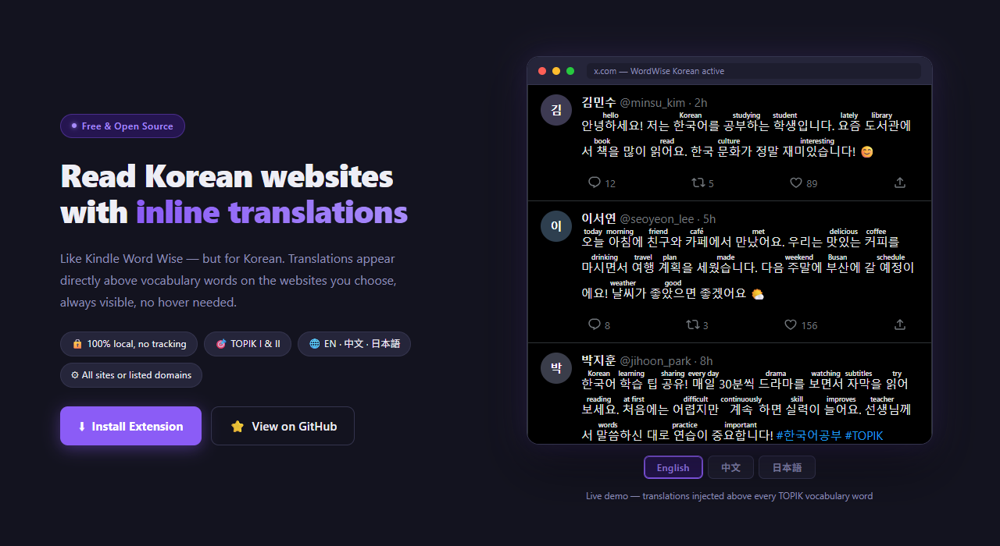

# WordWise Korean 📚

A browser extension that adds Kindle Word Wise style annotations for Korean language learning. Translations appear directly above vocabulary words - always visible, no hover needed!

🌐 **[Live Demo & Landing Page](https://multilingual-lab.github.io/wordwise_korean/)**





## ✨ Features

- **6,064 TOPIK words** — Level I (beginner), II (intermediate), or all
- **3 languages** — English, 中文, 日本語
- **Always-visible** — translations float above words, no hover required
- **Smart matching** — handles conjugated verbs and adjective forms
- **Website controls** — annotate all websites, or only domains you list
- **100% local** — no data sent, works on any Korean site

## 🚀 Installation

### Chrome / Brave
Install directly from the **[Chrome Web Store](https://chromewebstore.google.com/detail/wordwise-korean/ndngebbmafppnkdfilpcopmoeblhaech)** — one click, no setup needed.

### Firefox
1. Download the latest `wordwise-korean-X.Y.Z-firefox.zip` from [GitHub Releases](https://github.com/multilingual-lab/wordwise_korean/releases/latest)
2. Open `about:debugging` in Firefox
3. Click **Load Temporary Add-on** and select the ZIP

### Manual install (Edge / Opera / other Chromium browsers)
1. Download `wordwise-korean-X.Y.Z-chromium.zip` from [GitHub Releases](https://github.com/multilingual-lab/wordwise_korean/releases/latest)
2. Open your browser's extensions page and enable **Developer mode**
3. Drag and drop the ZIP onto the page

## 📖 Usage

1. Click the extension icon in your browser toolbar
2. Enable annotations using the toggle in the top-right corner of the popup
3. In the **Websites** tab, choose **Run on**:
   - **All websites**: Keep annotations enabled on all supported websites (the default).
   - **Only listed websites**: Annotate only domains you add. Click **Add this website** on X.com or a chat site, or expand **Manage allowed websites** to enter a domain or paste an HTTP(S) URL.
4. In the **Learning** tab (shown by default), select your vocabulary level:
   - **TOPIK I**: Basic vocabulary
   - **TOPIK II**: Intermediate/Advanced
   - **All**: Complete vocabulary
5. Select your translation language: **English**, **Chinese**, or **Japanese**
6. In the **Appearance** tab, adjust translation size and highlighting
7. Visit an enabled Korean website and see translations appear!

The annotations toggle remains in the header, alongside the title and a **Visit homepage** link. Current-site status stays below the header in every tab. The selected tab has a purple underline. Settings save immediately, and switching tabs keeps any domain you are typing. Use Left/Right arrows, Home, or End to navigate the tab bar with a keyboard. Only long website controls scroll within their panel; Learning and Appearance fit without panel scrollbars.

### Website controls

- Domains include their subdomains: `x.com` enables `x.com` and `www.x.com`, but not `notx.com` or `x.com.example.org`.
- Adding the current website uses its exact hostname, not a guessed parent domain. `twitter.com` and `x.com` are separate entries.
- Pasted URLs are reduced to domains: `https://x.com/home` becomes `x.com`. Paths and ports do not restrict matching.
- An empty list in **Only listed websites** mode disables annotations everywhere. Switching modes keeps your saved list.
- Removing a matching domain clears existing annotations immediately; adding one enables the page without refreshing.
- The **Annotations** toggle pauses everything without changing your mode or list.
- Embedded frames must match the list independently. To enable an embedded chat hosted on another domain, add that domain too.
- Browser-internal pages are unsupported. Website controls apply to HTTP(S) pages and do not reduce Chrome's existing all-site access permission.
- Your domain list syncs with your other extension settings through your browser's settings storage. It is not a browsing-history log.

## 🔧 For Developers

For versioning, package validation, GitHub releases, and Chrome Web Store submission, see the [release process](DEVELOPMENT.md#release-process). Release notes are in [CHANGELOG.md](CHANGELOG.md).

### Setup

1. **Install dependencies**:
```bash
pnpm install
# or npm install / yarn install
```

2. **Start development mode**:
```bash
pnpm dev
```

This will:
- Build the extension
- Open Chrome with the extension loaded on Naver Blog
- Watch for changes and auto-reload

### Running Tests
```bash
pnpm test          # Run all tests
pnpm test:watch    # Watch mode during development
pnpm test:sites    # Build Chrome extension and run popup + real-extension browser checks
pnpm test:extension # Check real annotations in the current Chrome build (including dev builds)
```

Tests cover translation precision, vocabulary data integrity, Korean stem matching, POS-aware collision resolution, domain matching, and live website activation. Browser checks use Puppeteer; set `CHROME_PATH` to a browser executable if needed (installed Chrome/Edge is detected on Windows).

`pnpm test:extension` loads the actual unpacked extension in Chrome and verifies rendered translations, live removal, domain restrictions, same-origin and cross-origin frames, and later chat messages. Run it in a second terminal while `pnpm dev` is running to also verify development content-script registration. Stop the dev server before `pnpm test:sites`, since that command replaces the Chrome output with a production build.

### Debugging
- Open extension popup and check console: Right-click → Inspect
- Content script logs: Open page console (F12)
- Background script: `chrome://extensions` → Details → Inspect views

Test on live Korean sites:
- https://ko.wikipedia.org/wiki/한국어
- https://news.naver.com
- https://twitter.com/search?q=한국어

### Building for Production

```bash
# Build for Chrome/Edge
pnpm build

# Build for Firefox
pnpm build:firefox

# Create distribution ZIP
pnpm zip
```

Output will be in `.output/` directory.

## ️ Tech Stack

- **Framework**: [WXT](https://wxt.dev/) - Modern extension development
- **UI**: Vue 3 + TypeScript
- **Styling**: Native CSS with ruby tag support
- **Build**: Vite
- **Manifest**: V3 (Chrome/Edge/Firefox compatible)

## 🐛 Troubleshooting

### Extension not working?

1. Check if extension is enabled in popup
2. In **Only listed websites** mode, check that the current domain is listed (settings apply without refreshing)
3. Check browser console for errors (F12 → Console)

For development, use the locked WXT version: older WXT releases can fail to register content scripts with newer Vite versions even though the popup opens. In noninteractive/automation environments, set `CI=true` when launching the dev server so Vite does not stop when stdin closes.

### Annotations not appearing?

- Make sure the page contains Korean text (Hangul characters)
- Verify vocabulary level includes the words
- Check if the site is using unsupported elements (SVG, Canvas)

### Performance issues?

- Reduce vocabulary level to decrease processing
- The extension uses debouncing (500ms) for dynamic content
- Some sites with heavy dynamic updates may experience slight delays

## 🗺️ Roadmap

- [x] Expand vocabulary to TOPIK I + II
- [x] Handle Korean verb/adjective conjugations
- [x] Filter common grammar particles
- [x] Translation quality pass (concise, no verbose prefixes, synonym dedup, tilde-description stripping)
- [x] Fix stem-matching collisions (살/살다, 배우/배우다, 서/서다, 해요/하다) — POS-aware two-pass lookup
- [x] Fix digit-compound annotation (1심, 2층, etc.)
- [x] Add Chinese and Japanese translations via Azure OpenAI batch translation
- [ ] Add more vocabulary

## 🤝 Contributing

Contributions welcome! Please:

1. Fork the repository
2. Create a feature branch (`git checkout -b feature/amazing-feature`)
3. Commit your changes (`git commit -m 'Add amazing feature'`)
4. Push to the branch (`git push origin feature/amazing-feature`)
5. Open a Pull Request

### Adding Vocabulary

Want to expand or customize the vocabulary? See [data/README.md](data/README.md) for:
- Original vocabulary sources
- How to re-scrape and merge new words
- Batch translation guide (Azure OpenAI)
- Quality control checklist

## 📄 License

MIT License - feel free to use this project for learning and development!

## 🙏 Acknowledgments

- Inspired by [Furigana Maker](https://github.com/aiktb/furiganamaker) for Japanese learning
- Built with [WXT](https://wxt.dev/) - amazing extension framework
- Korean vocabulary based on TOPIK standards

---

Made with ❤️ for Korean language learners

**Start learning Korean vocabulary while browsing the web! 화이팅! 💪**
